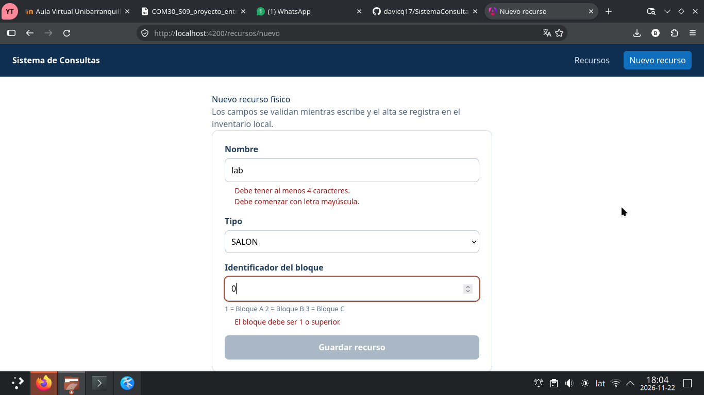
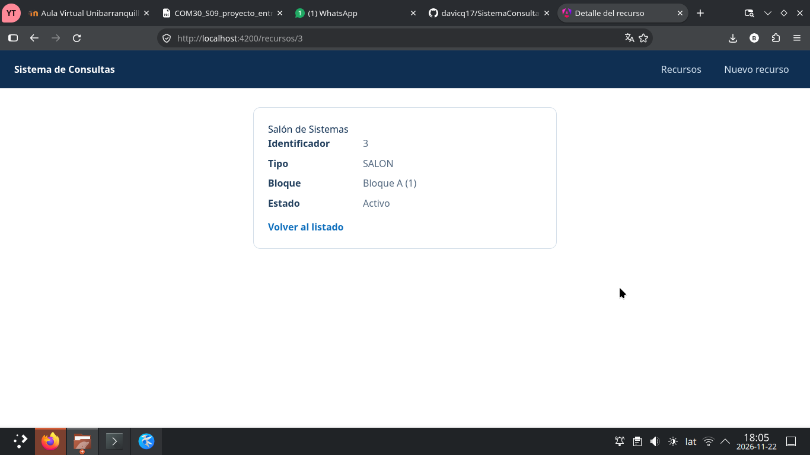

# COM30 · PROGRAMACIÓN CON FRAMEWORKS PARA WEB · 2026-III

## Proyecto · Entrega 2 · *SPA de varias vistas con formularios validados y búsqueda reactiva*

RA2 · RA3 · Corte 2 · 25 % del corte · Docente: Kevin Erney De Alba Pomárico

| Modalidad | Calificación | Criterios | Cierre |
| --- | --- | --- | --- |
| **Grupal** | **Escala 1.0 – 5.0** | **RA2 CE1–CE4 · RA3 CE1** | **Mar 24 nov · 23:59** |

| GRUPO: | INTEGRANTES: |
| --- | --- |
| 1 | Braynne Romero, David Carrillo, Hellen Arrieta |

---

## Propósito y condiciones

La Entrega 2 amplía la SPA de la Entrega 1 con navegación entre vistas, un formulario de alta reactivo con validación y una búsqueda que reacciona a lo que el usuario escribe. Vale el **25 % de la nota del Corte 2**. Los requisitos RF-E2-01 a RF-E2-08 de los lineamientos son su alcance mínimo.

| # | Condición |
| --- | --- |
| **1** | Se amplía el repositorio de la Entrega 1; no se crea uno nuevo. Datos locales: siguen vigentes. |
| **2** | Se evalúa el último commit de `master` anterior al cierre. El proyecto debe compilar con `npx ng build`. |
| **3** | Cada integrante tiene commits propios en esta entrega. Un integrante sin commits se califica de forma individual. |
| **4** | Asesoría sin calificación: en la sesión S09 del miércoles 11 de noviembre, por grupo, en la sala de trabajo de Teams. Las rutas, el parámetro con `input()`, la vista 404 y `loadComponent` se explicaron en esa sesión (repositorio de la clase, ruta `/s09`). |
| **5** | Cambio de fecha: el cierre pasó del miércoles 11 de noviembre, 17:00, al martes 17 de noviembre de 2026, 23:59. El alcance y la rúbrica no cambian. |

---

## Requerimiento *(los pesos suman 5.0)*

Se requiere que la SPA del grupo permita consultar el listado, abrir el detalle de un registro por su identificador en la ruta, agregar registros con un formulario validado y filtrar el listado por texto.

| Req. | Criterio de aceptación | Peso |
| --- | --- | --- |
| **R1** | README actualizado con la tabla de rutas y la justificación escrita de por qué el alta usa un formulario reactivo y no uno basado en plantillas (RF-E2-04). | 0.6 |
| **R2** | Tres vistas con ruta propia, detalle con parámetro entregado por `input()`, mensaje para un identificador inexistente, vista 404, `routerLinkActive` y `loadComponent` en al menos una ruta (RF-E2-01 a RF-E2-03). | 1.0 |
| **R3** | Formulario de alta con `FormBuilder` tipado, un control por campo, conversión del modelo de formulario al modelo de datos y alta mediante un método del servicio; el listado se actualiza sin recargar (RF-E2-04 y RF-E2-07). | 1.0 |
| **R4** | Cuatro validadores integrados distintos y uno propio; error visible solo con `touched` o `dirty`; envío deshabilitado mientras sea inválido (RF-E2-05 y RF-E2-06). | 1.0 |
| **R5** | Búsqueda con `valueChanges`, `debounceTime(300)` y `distinctUntilChanged`, sin suscripciones abiertas (RF-E2-08). | 0.8 |
| **R6** | Estructura de carpetas, repositorio público sin `node_modules`, commits de todos los integrantes y entrega a tiempo con el PDF completo. | 0.6 |

---

## Casos de verificación *(el grupo registra el resultado obtenido en cada uno)*

Los resultados se registraron sobre el código de `FRONTEND`; las capturas 1 y 2 se tomaron en navegador y se incluyen más adelante en esta sección.

| Entrada | Resultado esperado | Obtenido |
| --- | --- | --- |
| **Enviar el formulario con todos los campos vacíos** | Un mensaje por control tras tocarlo; envío deshabilitado | El botón «Guardar recurso» nace deshabilitado por `form.invalid`. Al tocar cada control aparecen sus mensajes de `required` (y `minlength` / `iniciaMayuscula` cuando aplica). |
| **Campo numérico con el mínimo menos uno y luego con el mínimo** | Con el mínimo menos uno, error `min`; con el mínimo, sin error | Con `bloqueId = 0` aparece «El bloque debe ser 1 o superior» (`Validators.min(1)`); con `1` el mensaje desaparece. |
| **Valor que incumple el validador propio y luego su corrección** | Mensaje del validador propio; desaparece al corregir | Con `laboratorio de redes` aparece «Debe comenzar con letra mayúscula»; con `Laboratorio de redes` desaparece. Cubierto por `inicia-con-mayuscula.validator.spec.ts`. |
| **Todos los campos válidos y envío** | El registro aparece en el listado sin recargar y el formulario se reinicia | `aRecursoFisicoRequest()` convierte el formulario y `RecursosService.crear()` actualiza la signal de solo lectura; `@for` del listado se recalcula sin recarga y `form.reset()` limpia los controles. Cubierto por `recurso-fisico.mapper.spec.ts` y `recursos.service.spec.ts`. |
| **Tres caracteres seguidos en la búsqueda en menos de 300 ms** | Una sola filtración, 300 ms después de la última tecla | Flujo `busqueda.valueChanges → debounceTime(300) → distinctUntilChanged() → toSignal()`, sin `subscribe()` manual; `toSignal` cancela la suscripción al destruir el componente. |
| **Navegar a `/detalle/99999` y a `/ruta-inexistente`** | Mensaje de registro no encontrado y vista 404 | En esta SPA: `/recursos/99999` muestra «No existe un recurso con el identificador 99999»; `/ruta-inexistente` redirige a `/404` y muestra `NotFoundPage`. |

---

## Evidencias *(se diligencian en este documento)*

| ENLACE DEL REPOSITORIO DEL GRUPO (DEBE ABRIR EN UNA VENTANA PRIVADA) |
| --- |
| https://github.com/davicq17/SistemaConsultas |

El enlace responde público (HTTP 200). **Nota para el docente:** el repositorio es compartido con el backend y las demás entregas del proyecto, por lo que el grupo no creó ni modificó la rama `master`. Todo el trabajo de esta entrega se encuentra en la rama `feat/frontend-agular` (nombre real de la rama del cliente en el repositorio), en los commits `0468127`, `e364d71`, `073aa4c`, `c5314b5` y `08a3888`, además del commit de actualización de este documento. Este mismo criterio se aplicó en la Entrega 1 y fue aceptado por el docente.

| TABLA DE RUTAS: RUTA · VISTA · PARÁMETRO |
| --- |
| `/` → redirección a `/auth/login` · — · — |
| `/auth/login` · `LoginPage` · — |
| `/auth/register` · `RegisterPage` · — |
| `/users/list` · `UserListPage` · — |
| `/recursos` · `RecursosListPage` · — |
| `/recursos/nuevo` · `RecursoCreatePage` · — |
| `/recursos/:id` · `RecursoDetailPage` · `id` por `input.required()` + `numberAttribute` |
| `/404` · `NotFoundPage` · — |
| `/**` → redirección a `/404` · — · — |

**COMMITS POR INTEGRANTE** · Transcríbalo como texto. No se aceptan imágenes de código.

```text
// pegue aquí la salida de:  git shortlog -sn
    68	davicq17
     4	Braynne Romero
     4	martin
     1	M4rt1nG24
     1	vane2004
```

Salida acotada a la entrega (`git shortlog -sn HEAD -- FRONTEND`):

```text
     3	Braynne Romero
     2	davicq17
     1	vane2004
```

Observación de autoría: `Braynne Romero` es el autor de esta entrega; `davicq17` corresponde a David Carrillo; `vane2004` corresponde a Hellen Arrieta, quien aportó el commit `c5314b5` de accesibilidad en el formulario de alta. `martin` y `M4rt1nG24` aparecen en el historial general del monorepo pero no en la lista del grupo. Los tres integrantes del grupo (Braynne Romero, David Carrillo y Hellen Arrieta) tienen commits propios en `FRONTEND`, con lo que se cumple la condición 3.

**EVIDENCIA · CAPTURA 1**
Captura 1 · El formulario con errores de validación visibles y el envío deshabilitado.



**EVIDENCIA · CAPTURA 2**
Captura 2 · La vista de detalle con el identificador visible en la barra de direcciones.



---

## Rúbrica de evaluación *(los pesos suman 5.0)*

| Criterio | Desempeño esperado | Peso |
| --- | --- | --- |
| **R1 · RA2 CE1** | README con tabla de rutas y justificación del tipo de formulario | 0.6 |
| **R2 · RA3 CE1** | Rutas, parámetro por `input()`, 404, `routerLinkActive` y carga diferida | 1.0 |
| **R3 · RA2 CE2** | Modelo de formulario y de datos distintos, alta por el servicio, listado actualizado | 1.0 |
| **R4 · RA2 CE4** | Validadores integrados y propio, mensajes con `touched` o `dirty`, envío deshabilitado | 1.0 |
| **R5 · RA2 CE3** | `valueChanges` con `debounceTime` y `distinctUntilChanged`, sin fugas | 0.8 |
| **R6** | Estructura, repositorio público sin `node_modules`, commits de todos, puntualidad | 0.6 |
|  | **TOTAL** | **5.0** |

> **Descuento de 0.3 por ocurrencia** de: `NgModule`, `*ngIf`, `*ngFor` o `@Input` en código nuevo; signal del servicio pública o modificada desde un componente; suscripción sin cancelar; `@for` sin `track`; contenido ficticio de relleno.

Comprobación de descuentos: en el código nuevo no hay `NgModule`, `*ngIf`, `*ngFor` ni `@Input`; los `@for` llevan `track`; `RecursosService` expone `readonly recursos = this.estado.asReadonly()` y el estado privado sólo se modifica dentro del servicio; no hay `subscribe()` manual.

---

## Entrega *(martes 24 de noviembre de 2026, 23:59 · actividad «Proyecto · Entrega 2» del aula)*

1. Verifique que el último commit está en `master` y que `npx ng build` termina sin errores.
2. Diligencie este documento con el enlace, la tabla de rutas, la salida de `git shortlog -sn`, los resultados de los seis casos y las dos capturas.
3. Un solo integrante lo sube como `COM30_Entrega2_GrupoN.pdf` (N es el número del grupo). La entrega queda registrada para todo el grupo.
4. Las consultas se envían a kerneydealba@unibarranquilla.edu.co, con el número de grupo y el mensaje de error completo.

Verificación local de compilación:

```text
$ cd FRONTEND && npx ng build
Application bundle generation complete. [4.711 seconds]
Initial total: 275.82 kB (75.42 kB transferencia estimada)
Output location: FRONTEND/dist/FRONTEND

$ npx ng test --watch=false --include 'src/app/features/recursos/**/*.spec.ts'
Test Files  4 passed (4)
Tests       7 passed (7)

```

Nota: se ejecutaron los specs nuevos de `features/recursos`. La suite completa (`npx ng test`) arrastra specs preexistentes rotos en otros módulos (`auth.guard`, `role.guard`, `login.page`, `solicitudes.service`, `solicitudes-list.page` y `smart-table.component`), que no se modificaron en esta entrega.

---

*Institución Universitaria de Barranquilla · COM30 Programación con Frameworks para Web · Proyecto integrador · 2026-III*
